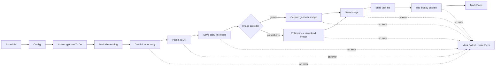

# n8n-xhs-autopost

[中文](README.md) | **English**

Write topics in Notion; n8n picks them up on a schedule, has Gemini write the copy and generate a cover image, publishes the note to the Xiaohongshu (RED) creator center with Playwright, and writes the result back to Notion.

## Features

- **Notion as a content queue**: `To Do → Generating → Done / Failed`, with the failure reason written to an `Error` field
- **Style-aware copywriting**: the prompt switches structure based on each topic's style (explainer / question / how-to / other); the persona is configurable
- **Two image providers**: Gemini image models (reliable, paid per use) or Pollinations (free)
- **Error handling**: network calls retry automatically; any failed step marks the Notion row `Failed` and records why
- **Standalone publisher**: `xhs_bot.py` works without n8n — give it a JSON file and it posts

## Workflow



## Project layout

```
├── xhs_bot.py                    # Playwright publisher (login / publish)
├── workflows/xhs-auto-post.json  # n8n workflow, import as-is
├── examples/task.example.json    # Example task file
├── downloads/                    # Runtime images and error screenshots (gitignored)
└── requirements.txt
```

## Prerequisites

- Python 3.9+
- Self-hosted [n8n](https://n8n.io) **on the same machine as `xhs_bot.py`** (the Execute Command node runs on the n8n host; if n8n runs in Docker, the container needs Python and Chromium)
- A Notion account and a [Notion integration](https://www.notion.so/my-integrations)
- A [Gemini API key](https://aistudio.google.com/apikey)
- A Xiaohongshu account

## Setup

### 1. Install the publisher

```bash
git clone https://github.com/XingjianWang001/n8n-xhs-autopost.git
cd n8n-xhs-autopost
pip install -r requirements.txt
python -m playwright install chromium
```

### 2. Log in to Xiaohongshu

```bash
python xhs_bot.py --mode login
```

A browser opens; scan the QR code with the Xiaohongshu app within 60 seconds. The session is saved to `xhs_state.json`.

> ⚠️ `xhs_state.json` holds your login cookies — treat it like a password. **Never share or commit it** (it is in `.gitignore`).

### 3. Create the Notion database

Create a database with these properties (**names and types must match**):

| Property | Type | Notes |
|---|---|---|
| `Name` | Title | Anything, for your reference |
| `Topic` | Text | **Input**: the topic |
| `Style` | Text or Select | **Input**: `科普/知识` (explainer), `提问/互动` (question), `干货/技巧` (how-to), or anything else |
| `Status` | Status | Must have options `To Do`, `Generating`, `Done`, `Failed` |
| `Title` | Text | Output: generated title |
| `Content` | Text | Output: generated body |
| `Tags` | Text | Output: generated hashtags |
| `Image URL` | URL | Output: image link (a placeholder when Gemini generates the image) |
| `Error` | Text | Output: failure reason |

Then open `···` → **Connections** on the database and add your integration. The database ID is the 32-character string after `notion.so/` and before `?v=` in the database URL.

### 4. Configure n8n

Since n8n 2.0, the Execute Command node is disabled by default and file access is restricted. Set these environment variables before starting n8n:

```bash
# Enable the Execute Command node
NODES_EXCLUDE="[]"
# Allow reading/writing the project directory (use your actual path)
N8N_RESTRICT_FILE_ACCESS_TO="C:/path/to/n8n-xhs-autopost"
```

Restart n8n after changing them.

### 5. Import the workflow

1. In n8n, **Import from File** → `workflows/xhs-auto-post.json`
2. Open the **Config** node and fill in the fields below
3. Select your **Notion API** credential in every Notion node and your **Google Gemini(PaLM) API** credential in both Gemini nodes
4. Add a row with `Status = To Do` in Notion and click **Execute Workflow** for a test run
5. Activate the workflow once it works (runs hourly by default; change it in Schedule Trigger)

### Config fields

| Field | Default | Notes |
|---|---|---|
| `BOT_DIR` | `C:/path/to/n8n-xhs-autopost` | Absolute path to this project, using `/` |
| `PYTHON` | `python` | **Absolute path** to the Python interpreter, e.g. `/path/to/n8n-xhs-autopost/.venv/bin/python`. Relative paths resolve from n8n's working directory, not `BOT_DIR`; the default `python` only works if it is on n8n's PATH |
| `HEADLESS` | `false` | Run the browser without a window. Headless is more likely to trigger anti-bot checks |
| `NOTION_DATABASE_ID` | — | Your Notion database ID |
| `PERSONA` | 一个喜欢分享生活小技巧的普通上班族 | Account persona, injected into the prompt |
| `IMAGE_STYLE` | soft pastel flat illustration… | Cover image style |
| `IMAGE_PROVIDER` | `gemini` | `gemini` or `pollinations` |
| `POLLINATIONS_KEY` | empty | Optional. When set, uses `gen.pollinations.ai`; when empty, uses the legacy anonymous endpoint |
| `GEMINI_TEXT_MODEL` | `gemini-3.5-flash-lite` | Copywriting model |
| `GEMINI_IMAGE_MODEL` | `gemini-3.1-flash-lite-image` | Image model (only used when `IMAGE_PROVIDER=gemini`) |

## Using the publisher on its own

```bash
python xhs_bot.py --mode publish_from_file --file examples/task.example.json
```

> ⚠️ This **really publishes** a note. The example points to `downloads/temp.jpg`; put an image there first.

A task file holds one object or an array of them (published in order):

```json
{
  "title": "Title (required)",
  "content": "Body",
  "tags": "#tag1 #tag2",
  "image_path": "Image path (required; relative paths resolve from the project root)"
}
```

| Option | Description |
|---|---|
| `--mode login` | Log in by QR code and save the session |
| `--mode publish_from_file --file <path>` | Publish from a task file |
| `--state <path>` | Session file, defaults to `xhs_state.json` in the project root |
| `--headless` | Run without a window (publish mode only) |
| `--cleanup` | Delete the task file and its images once every task is published (the workflow passes this; files are kept on failure for debugging) |

Exit code is `0` only if every task was published; otherwise `1`, and a screenshot is saved under `downloads/`.

## FAQ

**The Notion row is `Failed`**
Read the `Error` field, fix the cause, and set the status back to `To Do` to retry.

**The row is stuck at `Generating`**
The run stopped before error handling could run (for example n8n was shut down, or writing to Notion itself failed). Check n8n's Executions list, then set the status back to `To Do`.

**Error says `Success message not detected`**
The publish button was clicked but the success toast never appeared. **Check the creator center first** to avoid a duplicate post before retrying.

**Error says `Session expired`**
Run `python xhs_bot.py --mode login` again.

**Element not found / timeouts**
Xiaohongshu may have changed its UI; update the selectors in `xhs_bot.py`. The screenshots under `downloads/` help pinpoint what changed.

**Model not available**
Gemini models are updated and retired regularly. Pick a current one from the [Gemini model list](https://ai.google.dev/gemini-api/docs/models) and update `GEMINI_TEXT_MODEL` / `GEMINI_IMAGE_MODEL` in Config.

**The Gemini Image node says `not supported` or has no image option**
Your n8n version predates image generation in the Gemini node. Upgrade n8n, or set `IMAGE_PROVIDER` to `pollinations`.

**Writing `Image URL` to Notion fails**
With Gemini images the field receives the placeholder text `(generated by Gemini)`. If your Notion rejects non-URL values, change the placeholder on the last line of the **Parse Copy** node to any valid URL.

## Disclaimer

This project is for learning and research on automation only. Publishing with automation tools **may violate Xiaohongshu's terms of service** and can lead to reduced reach or account bans. Follow the platform's rules and applicable laws. **You use it at your own risk**; the author accepts no liability.

## License

[MIT](LICENSE)
