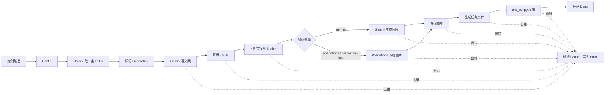

# n8n-xhs-autopost

**中文** | [English](README.en.md)

> An n8n workflow + Playwright script that turns topics in a Notion database into Xiaohongshu (RED) posts — copy written by Gemini, cover image generated by Gemini or Pollinations, published automatically.

在 Notion 里写下选题，n8n 定时取出，交给 Gemini 写文案、生成配图，再由 Playwright 自动发布到小红书创作者中心，最后把结果回写到 Notion。

## 功能

- **Notion 作为内容队列**：`To Do → Generating → Done / Failed`，失败原因写入 `Error` 字段
- **按风格写作**：根据选题的「风格」（科普 / 互动 / 干货 / 其他）自动切换文案结构，人设可配置
- **两种配图来源**：Gemini 图像模型（稳定，按量计费）或 Pollinations（免费）
- **完整的错误处理**：网络请求自动重试，任一步骤失败都会把 Notion 状态标为 `Failed` 并记录原因
- **发布脚本可单独使用**：`xhs_bot.py` 不依赖 n8n，给一个 JSON 就能发帖

## 工作流程



## 项目结构

```
├── xhs_bot.py                  # Playwright 发布脚本（登录 / 发布）
├── workflows/xhs-auto-post.json  # n8n workflow，直接导入
├── examples/task.example.json  # 任务文件示例
├── downloads/                  # 运行时图片和错误截图（已 gitignore）
└── requirements.txt
```

## 准备工作

- Python 3.9+
- 自托管的 [n8n](https://n8n.io)，**需要和 `xhs_bot.py` 运行在同一台机器上**（Execute Command 节点在 n8n 所在机器上执行命令；如果用 Docker 跑 n8n，容器里需要有 Python 和 Chromium）
- 一个 Notion 账号和 [Notion Integration](https://www.notion.so/my-integrations)
- 一个 [Gemini API Key](https://aistudio.google.com/apikey)
- 一个小红书账号

## 安装

### 1. 安装发布脚本

```bash
git clone https://github.com/XingjianWang001/n8n-xhs-autopost.git
cd n8n-xhs-autopost
pip install -r requirements.txt
python -m playwright install chromium
```

### 2. 扫码登录小红书

```bash
python xhs_bot.py --mode login
```

会弹出浏览器，60 秒内用小红书 App 扫码。登录态保存在 `xhs_state.json`。

> ⚠️ `xhs_state.json` 里是你的登录 cookie，等同于账号密码，**不要分享或提交**（已在 `.gitignore` 中）。

### 3. 创建 Notion 数据库

新建一个数据库，包含以下字段（**名称和类型必须一致**）：

| 字段 | 类型 | 说明 |
|---|---|---|
| `Name` | Title | 随便写，方便自己看 |
| `Topic` | Text | **输入**：选题，例如「通勤时间怎么利用」 |
| `Style` | Text 或 Select | **输入**：`科普/知识`、`提问/互动`、`干货/技巧` 或其他 |
| `Status` | Status | 需要有 `To Do`、`Generating`、`Done`、`Failed` 四个选项 |
| `Title` | Text | 输出：生成的标题 |
| `Content` | Text | 输出：生成的正文 |
| `Tags` | Text | 输出：生成的话题标签 |
| `Image URL` | URL | 输出：配图链接（Gemini 生成时为占位符） |
| `Error` | Text | 输出：失败原因 |

然后在数据库右上角 `···` → **Connections** 里添加你的 Integration。数据库 ID 是数据库链接中 `notion.so/` 后面、`?v=` 前面的那串 32 位字符。

### 4. 配置 n8n

n8n 2.0 起默认禁用 Execute Command 节点，并限制可读写的目录。启动 n8n 前设置环境变量：

```bash
# 启用 Execute Command 节点
NODES_EXCLUDE="[]"
# 允许读写项目目录（改成你的实际路径）
N8N_RESTRICT_FILE_ACCESS_TO="C:/path/to/n8n-xhs-autopost"
```

修改后需要重启 n8n。

### 5. 导入 workflow

1. n8n 中 **Import from File**，选择 `workflows/xhs-auto-post.json`
2. 打开 **Config** 节点，填写下表中的字段
3. 在所有 Notion 节点中选择 **Notion API** 凭据，在两个 Gemini 节点中选择 **Google Gemini(PaLM) API** 凭据（使用 Pollinations key 时另见下方 [Pollinations key](#pollinations-key可选)）
4. 在 Notion 中添加一条 `Status = To Do` 的记录，点击 **Execute Workflow** 手动试跑一次
5. 确认无误后激活 workflow（默认每小时运行一次，可在 Schedule Trigger 中修改）

### Config 字段

| 字段 | 默认值 | 说明 |
|---|---|---|
| `BOT_DIR` | `C:/path/to/n8n-xhs-autopost` | 本项目的绝对路径，用 `/` 分隔 |
| `PYTHON` | `python` | Python 解释器的**绝对路径**，例如 `C:/path/to/n8n-xhs-autopost/.venv/Scripts/python.exe`。相对路径以 n8n 进程的工作目录为基准，而不是 `BOT_DIR`；默认的 `python` 只有在 n8n 的 PATH 中能找到时才可用 |
| `HEADLESS` | `false` | 是否无窗口运行浏览器。无头模式更容易被风控，建议先用 `false` |
| `NOTION_DATABASE_ID` | — | Notion 数据库 ID |
| `PERSONA` | 一个喜欢分享生活小技巧的普通上班族 | 账号人设，会写进 prompt |
| `IMAGE_STYLE` | soft pastel flat illustration… | 配图风格（英文效果更好） |
| `IMAGE_PROVIDER` | `gemini` | `gemini`、`pollinations`（旧的匿名接口 `image.pollinations.ai`，无需 key）或 `pollinations-key`（`gen.pollinations.ai`，需要凭据，见下文） |
| `GEMINI_TEXT_MODEL` | `gemini-3.5-flash-lite` | 文案模型 |
| `GEMINI_IMAGE_MODEL` | `gemini-3.1-flash-lite-image` | 配图模型（仅 `IMAGE_PROVIDER=gemini` 时使用） |

### Pollinations key（可选）

key 不写在 Config 或 URL 里，而是保存在 n8n 凭据中：

1. 在 n8n 中新建一个 **Header Auth** 凭据：Name 填 `Authorization`，Value 填 `Bearer sk_...`（`Bearer` 后有一个空格）
2. 在 **Pollinations Image (Key)** 节点中选择这个凭据
3. 把 Config 中的 `IMAGE_PROVIDER` 改为 `pollinations-key`

必须使用 `sk_` 开头的 secret key；`pk_` 开头的 publishable key 会返回 `401`（见 [Pollinations APIDOCS](https://github.com/pollinations/pollinations/blob/main/APIDOCS.md#-authentication)）。

## 单独使用发布脚本

不用 n8n 也可以直接发帖：

```bash
python xhs_bot.py --mode publish_from_file --file examples/task.example.json
```

> ⚠️ 这会**真实发布**一篇笔记。示例中的图片路径是 `downloads/temp.jpg`，请先放一张图片进去。

任务文件可以是单个对象，也可以是数组（依次发布）：

```json
{
  "title": "标题（必填）",
  "content": "正文",
  "tags": "#标签1 #标签2",
  "image_path": "图片路径（必填，相对路径以项目根目录为基准）"
}
```

| 参数 | 说明 |
|---|---|
| `--mode login` | 扫码登录并保存登录态 |
| `--mode publish_from_file --file <path>` | 按任务文件发布 |
| `--state <path>` | 登录态文件路径，默认为项目根目录下的 `xhs_state.json` |
| `--headless` | 无窗口运行（仅发布模式） |
| `--cleanup` | 全部发布成功后删除任务文件及其中的图片（workflow 默认使用；失败时保留，便于排查） |

所有任务都发布成功时退出码为 `0`，否则为 `1`；失败时会在 `downloads/` 下保存截图。

## 常见问题

**Notion 状态变成了 `Failed`**
查看 `Error` 字段中的原因，处理后把状态改回 `To Do`，下次运行会重新处理。

**状态一直停在 `Generating`**
说明 workflow 在出错处理之前就中断了（例如 n8n 被关闭，或者回写 Notion 本身失败）。到 n8n 的 Executions 里查看具体原因。如果 Publish 已经成功、只是 Mark Done 重试后仍然失败，笔记其实已经发出，把状态直接改成 `Done`；否则改回 `To Do`，以免重复发帖。

**Error 显示 `Success message not detected`**
点了发布按钮，但没有检测到「发布成功」提示。**先去创作者中心确认是否已经发出**，再决定要不要重试，以免重复发帖。

**Error 显示 `Session expired`**
登录态过期了，重新运行 `python xhs_bot.py --mode login`。

**找不到元素 / 超时**
小红书改版后页面元素可能变化，需要更新 `xhs_bot.py` 中的选择器。可以参考 `downloads/` 下的错误截图定位问题。

**模型不可用**
Gemini 模型会定期更新和下线，到 [Gemini 模型列表](https://ai.google.dev/gemini-api/docs/models) 查找当前可用的模型，修改 Config 中的 `GEMINI_TEXT_MODEL` / `GEMINI_IMAGE_MODEL`。

**Gemini Image 节点报 `not supported` 或没有图像生成选项**
你的 n8n 版本太旧，Gemini 节点还不支持图像生成。升级 n8n，或者把 `IMAGE_PROVIDER` 改成 `pollinations`。

**`Image URL` 写入 Notion 失败**
使用 Gemini 配图时，这个字段写入的是占位文本 `(generated by Gemini)`。如果你的 Notion 拒绝非 URL 内容，在 **Parse Copy** 节点的最后一行把占位文本改成任意合法 URL 即可。

## 免责声明

本项目仅供学习和研究自动化技术使用。使用自动化工具发布内容**可能违反小红书用户协议**，并导致限流、封号等后果。请遵守平台规则和相关法律法规，**风险由使用者自行承担**，作者不对任何后果负责。

## License

[MIT](LICENSE)
